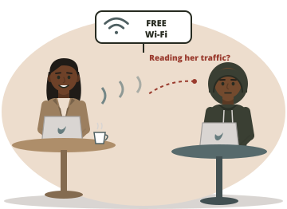

# Session 11.5: How data travels

**Day 3, 9:00 to 12:00.** On the map of the six jobs of security, this morning is about **Protect** (and a little **Detect**): protecting data on the move.

[Back to the course site](../index.html)

---

## Sachini at the hotel

Sachini, TeaLeaf's sales officer, is at a hotel in Kandy. She connects to the free Wi-Fi and checks customer orders. Is her data safe? This morning you will learn how to decide.

## What we know, and what we add today

On Day 1 we learned three words: a **threat** (what could go wrong), a **vulnerability** (a weakness) and a **risk** (the chance that a threat uses a weakness and causes harm). Today we add a fourth word:

> A **control** is anything that reduces a vulnerability.

The risk sentence now grows: *a threat uses a vulnerability, and a **control** reduces it.*

## This morning you will learn

1. Data travels in packets.
2. Public Wi-Fi is shared.
3. Firewall and VPN.
4. Controls in layers.

---

## 1. Data travels in packets

When you send an email, it does not travel in one piece. It is cut into small, numbered pieces called **packets**. Each packet is like a **postcard**: it has an address on the front, and anyone who handles it on the way could read it.

Every computer on the internet has an **IP address**, a number address such as `203.0.113.25`. People remember names, like `tealeaf.lk`, not numbers. **DNS** is the internet's phone book: it finds the IP address for a name.

| Stop | What happens |
|---|---|
| 1. Your laptop | Your message is cut into numbered packets |
| 2. The Wi-Fi router | The packets leave the building |
| 3. The internet | They pass through many computers on the way |
| 4. The website | The packets are put back in order |

## 2. Public Wi-Fi is shared

Wi-Fi in a hotel, cafe or airport is **shared with strangers**. That brings three dangers:

| Danger | What it means |
|---|---|
| Snooping | Someone on the same Wi-Fi watches the postcards go past |
| Fake hotspot | A criminal makes a Wi-Fi called "Hotel_Free_WiFi". You connect to them, not the hotel. |
| Old device | A laptop that is not updated can be attacked by other people on the same Wi-Fi |

What can the snooper see?

| How you connect | What the snooper sees |
|---|---|
| HTTP (no padlock) | Everything: the website, your password, your data |
| HTTPS (padlock) | The website's name, but not your password or data |
| HTTPS + VPN | Only that you are using a VPN. Not even the website's name. |

## 3. Firewall and VPN

A **firewall** is the guard at the office gate. It checks every connection coming in or going out, and blocks the ones that are not allowed.

A **VPN** is a private tunnel. It scrambles your data before it leaves your laptop and carries it safely across the internet, back to the office.

These two are easy to mix up. Ask one question: **gate or road?**

| | **Firewall: the gate** | **VPN: the road** |
|---|---|---|
| Where it works | At the edge of the office network | On the journey, outside the office |
| What it does | Blocks connections that are not allowed | Hides and protects your data while it travels |
| Helps Sachini at the hotel? | No. She is not behind the office gate. | Yes. Her data travels inside the tunnel. |

## 4. Controls in layers

No control stops everything. A firewall does not stop a phishing email. Training does not fix old software. So we use **layers of defence**: many controls together, like the walls, gate and guards of a castle.

| Control | The vulnerability it reduces |
|---|---|
| Training (Day 2) | Staff who trust fake emails and calls |
| MFA (Day 2) | Stolen passwords |
| Firewall | Connections that should not be allowed in |
| VPN | Data that travels on shared networks |
| Updates | Old software with known holes |
| Anti-malware | Bad files on USB sticks and in email |

> **Good to know (not in the test):** an **IDS** (intrusion detection system) is an alarm. It does not block attacks; it notices them and tells IT. That is the **Detect** job on the map.

---

## Games for this session

- [A3.1 Packet Journey](../artifacts/day3/a3-1-packet-journey.html): follow a packet from Sachini's laptop to the website.
- [A3.3 Coffee Shop Snooper](../artifacts/day3/a3-3-coffee-shop-snooper.html): see what a snooper sees with HTTP, HTTPS and a VPN.
- [A3.2 Castle Defence](../artifacts/day3/a3-2-castle-defence.html): choose four controls and watch eight attacks hit TeaLeaf.

## Check yourself

1. What does DNS do?

It finds the IP address for a name, like the internet's phone book. You type tealeaf.lk; DNS finds the number.

2. Sachini is on hotel Wi-Fi. TeaLeaf has a strong office firewall. Is her data protected? Why?

No. The firewall guards the office gate; Sachini is on the road, outside the office. She needs a VPN (or at least HTTPS websites).

3. A laptop shows a Wi-Fi called "Airport Free WiFi" and another called "Airport_Free_WiFi". What is the danger?

One may be a fake hotspot made by a criminal. Ask staff for the real name before connecting.

4. Why is one control never enough?

Each control covers a different weakness. An attack that one control misses can be stopped by another layer.

## Words to know

| Word | Simple meaning |
|---|---|
| Packet | A small, numbered piece of data |
| IP address | A number address that tells data where to go |
| DNS | The internet's phone book: finds the IP address for a name |
| Public Wi-Fi | Wi-Fi that many strangers share |
| Firewall | The guard at the gate: blocks connections that are not allowed |
| VPN | A private tunnel for data travelling outside the office |
| Control | Anything that reduces a vulnerability |
| Layers of defence | Many controls together, because one is never enough |

**Previous:** [Session 11.4: Proving who you are](11-04.html) | **Next:** [Session 11.6: Keeping secrets with keys](11-06.html)

DBIS-11 Cybersecurity and Cloud Computing. &copy; 2026 Niranga Dharmaratna, School of Computing &amp; Engineering, National Institute of Business Management. This work is licensed under <a href="https://creativecommons.org/licenses/by-nc-sa/4.0/">CC BY-NC-SA 4.0</a>. Illustrations are original and share the same licence. <a href="../LICENSE.html">Licence details</a>.

