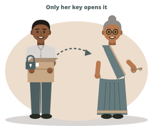

# Session 11.6: Keeping secrets with keys

**Day 3, 1:00 to 3:00. Test 3 is at 3:00.** On the map of the six jobs of security, this afternoon is about **Protect**: protecting the data itself.

[Back to the course site](../index.html)

---

## A question from a customer

A customer asks: *"Your website shows a padlock. Does that mean TeaLeaf is honest, and my card is safe?"* By the end of this afternoon you will know exactly what to tell her.

## This afternoon you will learn

1. Encryption.
2. Two kinds of key.
3. Hashing.

---

## 1. Encryption

**Encryption** turns a message into nonsense. Only the right **key** turns it back.

| Step | What you see |
|---|---|
| The message | `Pay Kasun LKR 85,000` |
| Locked with the key | `x7#Lq9 @mZ2! R8&vK1 0dW` |
| Unlocked with the key | `Pay Kasun LKR 85,000` |

Everyone may know **how** the lock works. Only the **key** is secret.

Encryption protects **confidentiality**, the C in CIA: even if someone gets the data, they cannot read it. We lock data in two places:

- **When it travels**, on cafe Wi-Fi or across the internet. HTTPS and the VPN do this.
- **When it is stored**, on a laptop or phone. If the laptop is stolen, the thief sees only nonsense.

## 2. Two kinds of key

### One shared key

Both sides use the **same key** to lock and unlock. It is fast. But there is a problem: **how do you send the key safely?** Email it, and a snooper copies it. Tape it to the box, and a thief gets both.

### The padlock way: two keys

| | **Public key** | **Private key** |
|---|---|---|
| Think of it as | An open padlock | The only key that opens it |
| Who has it | Anyone may have one | Only the owner |
| What it does | It can only **lock** | It **unlocks** |

The MD gives open padlocks to everyone. Kasun snaps the MD's padlock shut on the box. **No key ever travels**, and only the MD can open it.

### How the browser padlock uses both

The padlock way is safe but slow. A shared key is fast. So your browser uses **both**:

1. The padlock way, **once**, to send a shared key safely.
2. The fast shared key, for everything else: your password, your card.

This is **HTTPS**, the padlock in the address bar.

### What the padlock tells you, and what it does not

| It tells you | It does NOT tell you |
|---|---|
| Your data is locked on the way (**confidentiality**) | That the business is honest |
| The website's name is real (**authenticity**: the door from Day 2) | A criminal's fake shop can have a padlock too |

**Answer for the customer:** your card details are locked on the way, and the padlock proves you are talking to the real site name. It does not prove anyone is honest, so check that the address is really `tealeaf.lk`.

## 3. Hashing

**Hashing** makes a short **fingerprint** of data. Any change, even one letter, gives a completely different fingerprint.

| Text | Fingerprint (SHA-256, first part) |
|---|---|
| `Dimbula 200 kg: LKR 1,500 per kg` | `ad123eb1 0290bfbe 442b2654 ...` |
| `Dimbula 200 kg: LKR 1,600 per kg` | `56d86778 80a54689 2e309870 ...` |

TeaLeaf sends its price list with its fingerprint. The buyer makes the fingerprint again. Same fingerprint? The list was not changed. Different? Someone changed it. Hashing protects **integrity**, the I in CIA.

### Lock or fingerprint?

Encryption and hashing both make data look like nonsense, so people mix them up. Ask one question: **can you get the original back?**

| | **Lock: encryption** | **Fingerprint: hashing** |
|---|---|---|
| Get the original back? | **Yes**, with the key | **No**, never |
| Protects | Confidentiality | Integrity |

| Situation | Lock or fingerprint? |
|---|---|
| Keep the salary file secret from everyone except the MD. | Lock: encryption |
| Check that the price list was not changed on the way. | Fingerprint: hashing |
| A website stores passwords so that even IT cannot read them. | Fingerprint: hashing |

## Our toolbox for extended CIA

| Goal | Question | A tool we know |
|---|---|---|
| Confidentiality | Was it seen by the wrong person? | Encryption, VPN, HTTPS |
| Integrity | Was it changed wrongly? | Hashing |
| Availability | Could we not use it? | Backups and the cloud (Days 4 and 6) |
| Authenticity: the door | Is it real, now? | MFA, the HTTPS padlock |
| Accountability: the diary | Who did it, later? | Personal logins and logs |

---

## Games for this session

- [A3.4 The Key Box](../artifacts/day3/a3-4-the-key-box.html): help Kasun send the salary file, first with one shared key, then the padlock way.
- [A3.5 Hash Fingerprint](../artifacts/day3/a3-5-hash-fingerprint.html): make real fingerprints, check three copies of a price list, then sort: lock or fingerprint?
- [A3.6 Data Words Ladder](../artifacts/day3/a3-6-data-words-ladder.html): all fourteen words of the day. Tap **Hear it** to hear each word.

## Check yourself

1. Kasun emails the shared key to the MD, then sends the locked file. What is the problem?

Anyone who snoops on the email gets the key too, and can open the file. That is why the padlock way exists: no key has to travel.

2. A website has a padlock. Can you trust that the business is honest?

No. The padlock means the data is locked on the way and the site's name is real. A criminal's fake shop can have a padlock too.

3. The buyer's copy of the price list gives a different fingerprint. What does that tell the buyer?

The list was changed after TeaLeaf made the fingerprint. Integrity has been hurt. Do not use that copy; ask TeaLeaf to send it again.

4. Why do websites store a hash of your password, not the password locked with encryption?

A hash cannot be turned back, so even IT, or a thief who steals the database, cannot read the passwords. When you log in, the site hashes what you type and compares fingerprints.

## Test 3: how it works

At 3:00 you answer **two questions** on paper, one about the morning and one about the afternoon. Each question gives a short TeaLeaf situation and asks you to decide something and say why.

1. **Write** (35 min). No books, no phones.
2. **Photo** (5 min). Take clear photos. Make one PDF.
3. **Upload** (10 min) to the LMS. File name: `DBIS11_StudentID_Day3.pdf`
4. **Hand in** (5 min) your paper to the lecturer before you leave.

We mark your **ideas**, not your grammar. To prepare, play the Coffee Shop Snooper, Hash Fingerprint and the Data Words Ladder again. Watch the two look-alike pairs: **gate or road** (firewall or VPN) and **lock or fingerprint** (encryption or hashing).

## Words to know

| Word | Simple meaning |
|---|---|
| Encryption | Turning a message into nonsense that only the right key turns back |
| Shared key | One key both sides use. Fast, but hard to send safely |
| Public key | Like an open padlock: anyone may have it; it only locks |
| Private key | The only key that unlocks. Never shared |
| Hashing | Making a fingerprint of data. Any change gives a new one |
| HTTPS | The padlock: data is encrypted and the site's name is checked |

**Previous:** [Session 11.5: How data travels](11-05.html) | **Next:** [Session 11.7: What the cloud is](11-07.html)

DBIS-11 Cybersecurity and Cloud Computing. &copy; 2026 Niranga Dharmaratna, School of Computing &amp; Engineering, National Institute of Business Management. This work is licensed under <a href="https://creativecommons.org/licenses/by-nc-sa/4.0/">CC BY-NC-SA 4.0</a>. Illustrations are original and share the same licence. <a href="../LICENSE.html">Licence details</a>.

