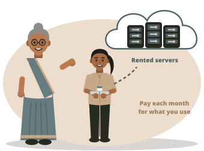

# Session 11.7: What the cloud is

**Day 4, 9:00 to 12:00.** On the map of the six jobs of security, today is about **Identify** (know what you have, and where it lives) and **Govern** (choose wisely, and set the rules).

[Back to the course site](../index.html)

---

## Dilani's broken server

*"Our server is eight years old. Last December it broke for two days, in our busiest week."* Dilani, TeaLeaf's MD, must decide what to do. Should TeaLeaf buy a new server, or use the cloud? First, we need to know what the cloud is.

## What we know, and what we add today

| What we know | From |
|---|---|
| **Availability**: could we not use it? Dilani's broken server is an availability problem. | Day 1 |
| **Controls**: MFA, training, firewall, VPN, encryption. TeaLeaf runs them itself. | Days 2 and 3 |

**New today:** renting computing, and some controls, from a provider. This is the cloud.

## This morning you will learn

1. What the cloud is.
2. Five features.
3. IaaS, PaaS, SaaS.
4. Public, private, hybrid.

---

## 1. What the cloud is

The **cloud** means renting computing (servers, storage, apps) over the internet, and paying for what you use. The cloud is real computers in real buildings, called data centres. They just belong to someone else.

The opposite is **on-premises**: your own computers, in your own building, that you buy and look after.

| | **On-premises: buy** | **Cloud: rent** |
|---|---|---|
| Example | A server in TeaLeaf's back room | Servers rented from a provider |
| You pay | A lot now | Each month |
| Repairs | TeaLeaf (Nadee) | The provider |
| Size | The same all year | More in December, less in January |

Big providers include Amazon (AWS), Microsoft (Azure) and Google. Local telecom companies also sell cloud.

## 2. Five features

Not everything "online" is cloud. Check the five features:

| Feature | What it means |
|---|---|
| Help yourself | You set it up yourself, in minutes, with no phone calls |
| Use it anywhere | It works over the internet, from any place |
| Shared by many | Many customers share the provider's big data centres |
| Grows and shrinks | You can add more, or less, when you need to |
| Pay for what you use | You pay each month for what you used, not up front |

Google Drive is cloud; a USB stick in a drawer is not. Renting four servers for December is cloud; buying four servers that sit idle from January is not.

## 3. IaaS, PaaS, SaaS

There are three ways to rent. They sound alike, so learn them with a pizza story.

| Job | Make it at home | Rent a kitchen | Bring your recipe to a pizza shop | Eat at a restaurant |
|---|---|---|---|---|
| Kitchen and oven | You | Shop | Shop | Shop |
| Tools and the chef | You | You | Shop | Shop |
| The recipe | You | You | You | Shop |
| Your order | You | You | You | You |

Now swap pizza for computing:

| Layer | On-premises | IaaS | PaaS | SaaS |
|---|---|---|---|---|
| Hardware (building, power, servers) | You | Provider | Provider | Provider |
| Operating system | You | You | Provider | Provider |
| Platform (tools to build apps) | You | You | Provider | Provider |
| The app | You | You | You | Provider |
| Your data | You | You | You | **You** |

**Your data is always your job.**

### What do you bring?

One question decides: **what do you bring?**

| | You bring | TeaLeaf example |
|---|---|---|
| **IaaS** (Infrastructure as a Service) | Everything except the hardware | Rented servers for December. Nadee installs everything. |
| **PaaS** (Platform as a Service) | Your own app | A place for a developer to run TeaLeaf's own shop app |
| **SaaS** (Software as a Service) | Only your data | Staff email, Zoom, online accounting |

## 4. Public, private, hybrid

One question decides: **who shares it?**

| Type | Who shares it | Like... |
|---|---|---|
| **Public cloud** | Many customers. Cheap and fast to start. | A bus |
| **Private cloud** | Only one organisation. More control, more cost. | Your own car |
| **Hybrid cloud** | Some of each, joined together | The car to the station, then the bus |

TeaLeaf could keep salary and contract files on its own private system, and run its online shop on a big provider. That is **hybrid**.

---

## Games for this session

- [A4.1 Is It Cloud?](../artifacts/day4/a4-1-is-it-cloud.html): look-alike pairs. Cloud, or not cloud?
- [A4.2 Pizza-as-a-Service](../artifacts/day4/a4-2-pizza-as-a-service.html): mark who looks after each layer, then choose IaaS, PaaS or SaaS for eight TeaLeaf needs.
- [A4.3 Deployment Matchmaker](../artifacts/day4/a4-3-deployment-matchmaker.html): public, private or hybrid? Ask who shares it.

## Check yourself

1. TeaLeaf's email runs on a server in the back room, bought in 2018. Is this cloud? Why?

No. It is on-premises: bought, not rented, and it cannot grow or shrink.

2. Kasun uses accounting software in the browser and pays a monthly fee. IaaS, PaaS or SaaS?

SaaS. It is a finished app that he just uses. TeaLeaf brings only its data.

3. In which one does TeaLeaf do the most work itself: IaaS, PaaS or SaaS?

IaaS. TeaLeaf looks after everything except the hardware.

4. A hospital keeps patient records in its own private cloud, and runs its booking website on a public cloud. Which type is this?

Hybrid cloud: some private, some public, joined together.

## Words to know

| Word | Simple meaning |
|---|---|
| Cloud | Renting computing over the internet, and paying for what you use |
| On-premises | Your own computers, in your own building, that you buy and look after |
| IaaS | Renting the machines. You look after everything on them |
| PaaS | Renting a ready place to build and run your own app |
| SaaS | Renting a finished app that you just use |
| Public cloud | Cloud shared by many customers, run by a big provider |
| Private cloud | Cloud used by one organisation only |
| Hybrid cloud | Public and private cloud, joined together |

**Previous:** [Session 11.6: Keeping secrets with keys](11-06.html) | **Next:** [Session 11.8: Buy or rent?](11-08.html)

DBIS-11 Cybersecurity and Cloud Computing. &copy; 2026 Niranga Dharmaratna, School of Computing &amp; Engineering, National Institute of Business Management. This work is licensed under <a href="https://creativecommons.org/licenses/by-nc-sa/4.0/">CC BY-NC-SA 4.0</a>. Illustrations are original and share the same licence. <a href="../LICENSE.html">Licence details</a>.

