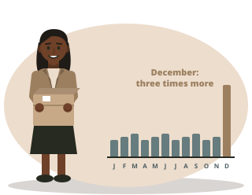
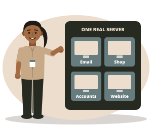

# Session 11.8: Buy or rent?

**Day 4, 1:00 to 3:00. Test 4 is at 3:00.** On the map of the six jobs of security, this afternoon is still about **Identify** and **Govern**: knowing what TeaLeaf needs, and choosing with open eyes.

[Back to the course site](../index.html)

---

## The December question

Every December, TeaLeaf's orders are three times higher. Should TeaLeaf buy a bigger server, or rent? By 3:00 you will be able to recommend one, and say why.

## This afternoon you will learn

1. Virtual machines.
2. Buy or rent.
3. Hidden costs and lock-in.

---

## 1. Virtual machines

A **virtual machine** is a pretend computer that runs inside a real one. One real server can hold many.

Think of flats in one building. Each family has its own locked flat, but they share the building. If the building has no power, every flat is dark.

| Why the cloud uses them | |
|---|---|
| Saves money | One machine, fully used, instead of five half-empty ones |
| Ready in minutes | A new one is made by software. Help yourself. |
| Can move | Providers move it to another real server if one breaks |

> **When it goes wrong:** if the one real server breaks, every virtual machine on it stops. That hurts **availability**, the A in CIA. Cloud providers own thousands of real servers, so they can move your virtual machine.

> **Good to know (not in the test):** **containers** are an even lighter way to share one machine.

## 2. Buy or rent

| | **Buy a server** | **Rent cloud** |
|---|---|---|
| When you pay | A lot now, then running costs | Nothing now, then every month |
| Size | Big enough for December, all year | Grows in December, shrinks in January |
| Who repairs it | TeaLeaf (Nadee) | The provider |
| If it breaks | Down until it is fixed | The provider moves it to another server |
| Cash | Ties up cash TeaLeaf needs for tea stock | Keeps cash free |

**There is no single answer.** Sample figures from the Server or Cloud game, over 3 years:

| December orders | Buy a server | Rent cloud | Cheaper |
|---|---|---|---|
| Same as other months | LKR 2.76 million | LKR 2.88 million | Buy (a little) |
| Three times higher | LKR 3.96 million | LKR 3.36 million | Rent |

The bigger the peak, the more renting saves. *(Sample figures, for practice only.)*

## 3. Hidden costs and lock-in

A **hidden cost** is a cost you did not expect when you signed up.

| Hidden cost | Control |
|---|---|
| Test servers left running for months | Turn off what you do not use |
| Charges when data leaves the cloud | Read the price list |
| Nobody checks the bill, so small costs grow | Check the bill every month |

**Lock-in** is when it is very hard or costly to move to another provider. After two years prices rise, but moving TeaLeaf's shop would take months. The control: **ask how to get your data out before you sign.**

### Cloud risks, in our risk words

| Threat | Vulnerability | Control |
|---|---|---|
| The provider has an outage | Everything is with one provider | Check the uptime promise; keep a backup elsewhere |
| Prices rise | Lock-in: data is hard to move | Ask how to get data out before signing |
| A surprise bill | Nobody watches the costs | Check the bill monthly; turn off unused servers |

An outage hurts **availability**, the A in CIA.

> **Good to know (not in the test):** a promise of 99.9% uptime still allows about 9 hours down a year.

---

## Games for this session

- [A4.4 Stack It](../artifacts/day4/a4-4-stack-it.html): fit TeaLeaf's virtual machines on one real server, then see what December does.
- [A4.5 Server or Cloud?](../artifacts/day4/a4-5-server-or-cloud.html): move the December slider, tick hidden costs, and compare 3-year costs.
- [A4.6 Cloud Words Ladder](../artifacts/day4/a4-6-cloud-words-ladder.html): all thirteen words of the day. Tap **Hear it** to hear each word.

## Check yourself

1. The real server breaks. What happens to the five virtual machines on it?

They all stop. That hurts availability.

2. Why must a bought server be big enough for December all year?

A bought server cannot grow for one month. So TeaLeaf pays for December's size in all twelve months.

3. A business has the same sales every month. Is renting always cheaper?

No. With no peak, buying can be a little cheaper. The answer depends on the peak, the cash, and the hidden costs.

4. What should TeaLeaf ask before it signs with a cloud provider, to avoid lock-in?

How to get its data out, and how long that would take.

## Test 4: how it works

At 3:00 you answer **two questions** on paper, one about the morning and one about the afternoon. Each question gives a short TeaLeaf situation and asks you to decide something and say why.

1. **Write** (35 min). No books, no phones.
2. **Photo** (5 min). Take clear photos. Make one PDF.
3. **Upload** (10 min) to the LMS. File name: `DBIS11_StudentID_Day4.pdf`
4. **Hand in** (5 min) your paper to the lecturer before you leave.

We mark your **ideas**, not your grammar. To prepare, play Pizza-as-a-Service, Server or Cloud and the Cloud Words Ladder again. Remember the two deciding questions: **what do you bring?** (IaaS, PaaS, SaaS) and **who shares it?** (public, private, hybrid).

## Words to know

| Word | Simple meaning |
|---|---|
| Virtual machine | A pretend computer that runs inside a real one |
| Pay as you go | Paying only for what you use, each month |
| Scaling | Growing or shrinking how much you rent, when you need to |
| Hidden cost | A cost that you did not expect when you signed up |
| Lock-in | When it is very hard or costly to move to another provider |

**Previous:** [Session 11.7: What the cloud is](11-07.html) | **Next:** [Session 11.9: Whose job is it?](11-09.html)

DBIS-11 Cybersecurity and Cloud Computing. &copy; 2026 Niranga Dharmaratna, School of Computing &amp; Engineering, National Institute of Business Management. This work is licensed under <a href="https://creativecommons.org/licenses/by-nc-sa/4.0/">CC BY-NC-SA 4.0</a>. Illustrations are original and share the same licence. <a href="../LICENSE.html">Licence details</a>.

