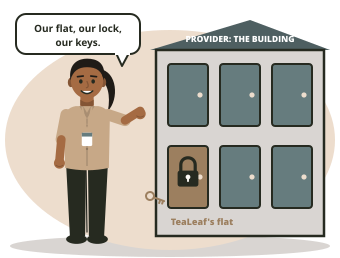

# Session 11.9: Whose job is it?

**Day 5, 9:00 to 12:00.** On the map of the six jobs of security, today is about **Govern** (who is responsible, and the rules) and **Protect** (the settings that keep data safe).

[Back to the course site](../index.html)

---

## Kasun's mistake

TeaLeaf has moved to the cloud. Kasun says: *"Good. Now the provider looks after all our security."* Is he right? By the end of this morning you will know.

## What we know, and what we add today

| What we know | From |
|---|---|
| **What do you bring?** IaaS: all but the hardware. PaaS: your own app. SaaS: only your data. | Day 4 |
| **Personal logins**: everyone has their own, so actions can be traced. | Day 2 |

**New today:** what you bring, you protect. The provider protects the rest.

## This morning you will learn

1. Shared responsibility.
2. Always ours: data, passwords, access.
3. Leaving things open (misconfiguration).
4. Choosing a provider.

---

## 1. Shared responsibility

**Shared responsibility** means the provider looks after the cloud itself, and the customer looks after what it puts in the cloud.

Think of renting a flat. The owner keeps the building safe. You lock your own door and decide who gets a key.

One question decides: **building or belongings?**

| **The provider: the building** | **TeaLeaf: the belongings** |
|---|---|
| Data centre guards and locks | Its data |
| Power and air conditioning | Its passwords and MFA |
| Hardware and cables | Who gets access |
| Whatever the provider brings (Day 4) | Its settings: private or open? |

The line moves with IaaS, PaaS and SaaS. **What you bring, you protect.**

| Who protects... | IaaS | PaaS | SaaS |
|---|---|---|---|
| Building, power, hardware | Provider | Provider | Provider |
| Operating system and its updates | TeaLeaf | Provider | Provider |
| The app | TeaLeaf | TeaLeaf | Provider |
| Data, passwords, who gets access | **TeaLeaf** | **TeaLeaf** | **TeaLeaf** |

So Kasun was wrong. The provider looks after the building, not everything.

## 2. Always ours

Whatever TeaLeaf rents, three things are always its job:

- **Its data**: what it stores, whether it is correct, and whether it is needed at all.
- **Its passwords and MFA**: a provider cannot protect an account whose password is `admin123`.
- **Who gets access** (**access control**): who can open what, and removing leavers on their last day.

> **Good to know (not in the test):** the cloud is not a backup unless backups are set up and tested.

## 3. Leaving things open

**Misconfiguration** means setting something up wrongly, or leaving it open by mistake. It is a cloud **vulnerability**, and one of the top causes of cloud data leaks. Nobody breaks in: the door was simply left open.

| Setting left open | What can happen | Fix |
|---|---|---|
| A folder open to anyone on the internet | Strangers read customer orders | Named staff only |
| MFA off on the admin account | A stolen password takes over everything | Turn MFA on |
| A link that lets anyone edit | Prices are changed by strangers | Named people, view only |
| A leaver's login still active | An ex-staff member can still get in | Remove on the last day |
| A default password never changed | Attackers try it first | A long passphrase and MFA |

Every one of these is TeaLeaf's job: belongings, not the building.

## 4. Choosing a provider

Ask six questions before you sign:

| Question | Why it matters |
|---|---|
| Where is our data kept? | You should know which country |
| Are there backups we can restore? | So data can come back |
| What uptime is promised? | Availability: 99.9% or better |
| Is there a security certificate? | For example ISO/IEC 27001 |
| Can we get our data out easily? | To avoid lock-in (Day 4) |
| Is there MFA for every account? | Not password only (Day 2) |

The cheapest provider is not always the best one.

---

## Games for this session

- [A5.1 Whose Job Is It?](../artifacts/day5/a5-1-whose-job-is-it.html): give each security job to the provider or to TeaLeaf.
- [A5.2 Misconfiguration Hunt](../artifacts/day5/a5-2-misconfiguration-hunt.html): find the risky settings on a pretend cloud screen.
- [A5.3 Provider Scorecard](../artifacts/day5/a5-3-provider-scorecard.html): score three pretend providers with the checklist.

## Check yourself

1. The provider's data centre has guards and cameras. Whose job is that?

The provider's. It is the building.

2. TeaLeaf rents servers as IaaS. Who updates the operating system?

TeaLeaf. With IaaS, TeaLeaf brings everything except the hardware, so it protects the operating system too.

3. An orders folder was left open to the internet. Is this the provider's fault?

No. It is a misconfiguration of something TeaLeaf put in the cloud: TeaLeaf's job. Fix: set it to named staff only, and check settings regularly.

4. A provider is very cheap, but has no backups and no MFA. Should TeaLeaf choose it?

No. It fails important checks. Choose with the checklist, not the price.

## Words to know

| Word | Simple meaning |
|---|---|
| Shared responsibility | The provider looks after the cloud; the customer looks after what it puts in it |
| Cloud provider | The company that rents out the cloud |
| Access control | Deciding who can open what. Always the customer's job |
| Misconfiguration | Setting something up wrongly, or leaving it open by mistake |

**Previous:** [Session 11.8: Buy or rent?](11-08.html) | **Next:** [Session 11.10: Personal data and the law](11-10.html)

DBIS-11 Cybersecurity and Cloud Computing. &copy; 2026 Niranga Dharmaratna, School of Computing &amp; Engineering, National Institute of Business Management. This work is licensed under <a href="https://creativecommons.org/licenses/by-nc-sa/4.0/">CC BY-NC-SA 4.0</a>. Illustrations are original and share the same licence. <a href="../LICENSE.html">Licence details</a>.

