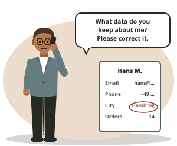

# Session 11.10: Personal data and the law

**Day 5, 1:00 to 3:00. Test 5 is at 3:00.** On the map of the six jobs of security, this afternoon is about **Govern**: the law sets rules for every business, and the business sets rules for its staff.

[Back to the course site](../index.html)

---

## Sachini's shortcut

Sachini wants to paste TeaLeaf's customer list into a free AI chatbot, to write sales emails faster. Should TeaLeaf allow it? By the end of this afternoon you will know, and why.

## This afternoon you will learn

1. Personal data.
2. The PDPA: customers' rights, and TeaLeaf's duties.
3. Security rules for staff, including AI chatbots.

---

## 1. Personal data

**Personal data** is any information that can point to a person, directly or indirectly. The person it is about is the **data subject**.

One question decides: **can it point to a person?**

| Information | Personal data? | Why |
|---|---|---|
| Hans's email address | Yes | It points to Hans |
| TeaLeaf's company phone number | No | It is about a company |
| The price of Dimbula tea | No | It is about a product |
| "The only buyer in Hamburg who orders green tea" | Yes | No name, but it still points to one person |
| A customer's photo | Yes | It points to a person |

## 2. The PDPA

Sri Lanka's law on personal data is the **Personal Data Protection Act (PDPA), No. 9 of 2022**, amended by Act No. 22 of 2025. The **Data Protection Authority (DPA)** is the regulator. The law gives customers **rights**, and gives businesses **duties**.

### Where the law stands (checked 22 November 2026)

| Part of the law | Status |
|---|---|
| The Data Protection Authority | Working since 2023 |
| Business duties: how to use personal data | Start on 1 January 2027 |
| Data Protection Officers, reporting breaches | Start on 1 January 2027 |
| Customers' rights | In the Act; start date not set yet |
| Penalties | In the Act; start date not set yet |

> **Dates can change.** Always check the latest on the [Data Protection Authority's website](https://www.dpa.gov.lk/).

### Four rights: see, fix, delete, stop

| Verb | Right | What the customer can ask |
|---|---|---|
| **See** | Right of access | To see what data is kept, and how it is used |
| **Fix** | Right to correct | To fix wrong data, or complete missing data |
| **Delete** | Right to erase | To have the data deleted |
| **Stop** | Right to withdraw consent, or object | To stop the data being used |

**Consent** is a person's clear agreement to their data being used for a reason. They can take it back later.

> **Good to know (not in the test):** there is also a right to ask for a person to review a decision made only by a computer.

### Five duties for TeaLeaf

1. **Have a lawful reason, and say it.** Tell people why you collect their data, for example to deliver orders.
2. **Use it only for that reason.** Data given to deliver tea is not for something else.
3. **Only what you need.** Do not collect more than the reason needs.
4. **Correct, and not kept for ever.** Keep it up to date; delete it when it is no longer needed.
5. **Keep it safe.** Encryption, MFA, access control: everything from Days 2 to 5.

> **Good to know (not in the test):** when TeaLeaf sells to people in Europe, Europe's law, the GDPR, can apply too.

## 3. Security rules for staff

A **security policy** is a short list of security rules that everyone in the business must follow. It helps prevent a **data breach**: personal data lost, stolen, or seen by the wrong people.

### Customer data and free AI chatbots

| | |
|---|---|
| **Why not?** | The customers' personal data leaves TeaLeaf, to a company TeaLeaf has no contract with. It may be kept, and it cannot be taken back. |
| **Which duties break?** | *Use it only for the reason given*: customers gave it to buy tea. *Keep it safe*: TeaLeaf no longer controls it. |
| **The safer way** | Ask the AI to improve an email with **no** customer details. Or use an AI tool TeaLeaf has approved, with a proper contract. |

**Rule: never paste customer data into free AI chatbots.**

### A good staff policy for TeaLeaf

1. Use your own login. Never share it.
2. Turn on MFA for email and the cloud.
3. Never paste customer data into free AI chatbots or other outside apps.
4. Share cloud files with named people only, never "anyone with the link".
5. Report a lost phone or a strange email to Nadee at once.
6. Collect only the customer data we need.
7. Lock your screen when you leave your desk.

---

## Games for this session

- [A5.4 Rights Rumble](../artifacts/day5/a5-4-rights-rumble.html): match customer requests to rights: see, fix, delete or stop.
- [A5.5 Policy Builder](../artifacts/day5/a5-5-policy-builder.html): build TeaLeaf's staff policy, then answer three AI chatbot questions.
- [A5.6 Law Words Ladder](../artifacts/day5/a5-6-law-words-ladder.html): all twelve words of the day. Tap **Hear it** to hear each word.

## Check yourself

1. Is TeaLeaf's company phone number personal data?

No. It is about a company, not a person.

2. A customer says: "Stop sending me tea offers." Which right is she using?

The right to stop: she withdraws consent, or objects, to her data being used for this.

3. Customers gave their phone numbers to get deliveries. Can TeaLeaf use them for a new marketing campaign without asking?

No. Use it only for the reason given. TeaLeaf would need the customers' consent first.

4. Why must customer data never go into a free AI chatbot?

It is personal data. It leaves TeaLeaf to an outside company, may be kept, and cannot be taken back, so TeaLeaf can no longer keep it safe or use it only for the reason given.

## Test 5: how it works

At 3:00 you answer **two questions** on paper, one about the morning and one about the afternoon. Each question gives a short TeaLeaf situation and asks you to decide something and say why.

1. **Write** (35 min). No books, no phones.
2. **Photo** (5 min). Take clear photos. Make one PDF.
3. **Upload** (10 min) to the LMS. File name: `DBIS11_StudentID_Day5.pdf`
4. **Hand in** (5 min) your paper to the lecturer before you leave.

We mark your **ideas**, not your grammar. To prepare, play Whose Job Is It?, the Misconfiguration Hunt and the Policy Builder again. Remember the two deciding questions: **building or belongings?** and **can it point to a person?**

## Words to know

| Word | Simple meaning |
|---|---|
| Personal data | Any information that can point to a person, directly or indirectly |
| Data subject | The person the personal data is about |
| PDPA | Sri Lanka's Personal Data Protection Act, No. 9 of 2022 |
| Consent | A person's clear agreement to their data being used for a reason |
| Right of access | A person's right to see what data a business keeps about them |
| Right to erase | A person's right to ask for their data to be deleted |
| Data breach | Personal data lost, stolen, or seen by the wrong people |
| Security policy | A short list of security rules that everyone must follow |

**Previous:** [Session 11.9: Whose job is it?](11-09.html) | **Next:** [Session 11.11: Managing risk](11-11.html)

DBIS-11 Cybersecurity and Cloud Computing. &copy; 2026 Niranga Dharmaratna, School of Computing &amp; Engineering, National Institute of Business Management. This work is licensed under <a href="https://creativecommons.org/licenses/by-nc-sa/4.0/">CC BY-NC-SA 4.0</a>. Illustrations are original and share the same licence. <a href="../LICENSE.html">Licence details</a>.

