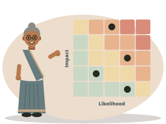

# Session 11.11: Managing risk

**Day 6, 9:00 to 12:00.** On the map of the six jobs of security, this morning is about **Identify** (find and measure the risks) and **Govern** (decide what to do, and who owns each risk).

[Back to the course site](../index.html)

---

## Dilani's question

*"Nadee has listed thirty risks. We have money to deal with only a few. Which ones first?"* This morning gives TeaLeaf a method.

## What we know, and what we add today

| What we know | From |
|---|---|
| **Threat, vulnerability, risk** | Day 1 |
| **Control**: anything that reduces a vulnerability | Day 3 |
| **Cloud risks**: outages, lock-in, misconfiguration | Days 4 and 5 |

**New today:** how big is each risk? And what do we do about it?

## This morning you will learn

1. Likelihood and impact.
2. The risk matrix.
3. Four responses.
4. The risk register.

---

## 1. Likelihood and impact

Two words that sound alike. One question keeps them apart: **chance or damage?**

| Score | **Likelihood**: how likely? (the chance) | **Impact**: how bad? (the damage to C, I or A) |
|---|---|---|
| 1 | Rare | Tiny |
| 2 | Unlikely | Small |
| 3 | Possible | Medium |
| 4 | Likely | Big |
| 5 | Almost certain | Severe |

**Risk score = likelihood x impact.**

Example: a phishing email tricks a member of staff. Phishing emails arrive every week (likelihood 4). One mistake can cost money or data (impact 3). **Score: 4 x 3 = 12. High.**

## 2. The risk matrix

A **risk matrix** is a 5 x 5 grid. Likelihood goes along the bottom, impact goes up the side. The biggest risks sit in the **top-right corner**: deal with those first.

| Score | Level | What to do |
|---|---|---|
| 20 to 25 | Very high | Act now |
| 10 to 16 | High | Act soon |
| 5 to 9 | Medium | Plan and watch |
| 1 to 4 | Low | Usually accept |

## 3. Four responses

Four look-alike verbs. One question decides: **what happens to the risk?**

| Response | What happens to the risk | TeaLeaf example |
|---|---|---|
| **Avoid** | **Gone**: stop the risky activity | Do not allow the customer database on personal laptops |
| **Reduce** | **Smaller**: add a control | Training and MFA against phishing |
| **Transfer** | **Moved**: someone else pays, for example an insurer | Fire insurance for the server room |
| **Accept** | **Kept**: live with it, because it is small | A price typo that is caught the same day |

Match the response to the size of the risk. Do not spend a lot on small risks.

## 4. The risk register

A **risk register** is a table of risks, each with an **owner**, a score and an action. On Day 1, information had an owner. Today, **every risk has an owner**: the person who watches it and acts on it.

| Risk | Owner | Score | Response and action |
|---|---|---|---|
| Ransomware locks the server | Nadee | 3 x 5 = 15 | Reduce: offline backups, updates |
| Phishing tricks staff | Nadee | 4 x 3 = 12 | Reduce: training and MFA |
| Orders folder left open | Nadee | 3 x 4 = 12 | Reduce: monthly settings check |
| Fire in the server room | Dilani (MD) | 1 x 5 = 5 | Transfer: fire insurance |
| A price typo, caught the same day | Kasun | 4 x 1 = 4 | Accept |

### Prevent, detect or fix?

The week's controls fall into three groups. One question decides: **before, during or after?**

| Group | When | Examples from this week |
|---|---|---|
| **Prevent** | Before: stops it happening | Firewall, MFA, training, updates, encryption |
| **Detect** | During: notices it happening | Alarms, alerts, logs, a staff report, a hash check |
| **Fix** | After: repairs the damage | Restore a backup, reset a password, clean a laptop |

---

## Games for this session

- [A6.1 Risk Matrix Plotter](../artifacts/day6/a6-1-risk-matrix-plotter.html): score eight TeaLeaf risks and see them on the matrix.
- [A6.2 Treat It!](../artifacts/day6/a6-2-treat-it.html): choose avoid, reduce, transfer or accept for seven risks, with a fixed budget.
- [A6.3 Prevent, Detect or Fix?](../artifacts/day6/a6-3-prevent-detect-or-fix.html): sort the week's controls.

## Check yourself

1. A risk has likelihood 3 and impact 5. What is its score, and how serious is it?

3 x 5 = 15. High: act soon.

2. TeaLeaf buys fire insurance. Which response is this?

Transfer. The risk is moved: the insurer pays the cost.

3. Why is accepting a risk sometimes the right choice?

When the risk is small, fixing it can cost more than the damage it would cause.

4. An alert says someone logged in from another country. Prevent, detect or fix?

Detect. It notices something happening.

## Words to know

| Word | Simple meaning |
|---|---|
| Likelihood | How likely a risk is to happen, from 1 (rare) to 5 (almost certain) |
| Impact | How bad the damage would be, from 1 (tiny) to 5 (severe) |
| Risk matrix | A 5 x 5 grid that places risks by likelihood and impact |
| Risk register | A table of risks: each with an owner, a score and an action |
| Risk owner | The person who watches a risk and acts on it |
| Avoid | Stop the risky activity, so the risk is gone |
| Reduce | Add a control, so the risk is smaller |
| Transfer | Move the cost to someone else, for example an insurer |
| Accept | Keep a small risk and live with it |

**Previous:** [Session 11.10: Personal data and the law](11-10.html) | **Next:** [Session 11.12: When things go wrong](11-12.html)

DBIS-11 Cybersecurity and Cloud Computing. &copy; 2026 Niranga Dharmaratna, School of Computing &amp; Engineering, National Institute of Business Management. This work is licensed under <a href="https://creativecommons.org/licenses/by-nc-sa/4.0/">CC BY-NC-SA 4.0</a>. Illustrations are original and share the same licence. <a href="../LICENSE.html">Licence details</a>.

