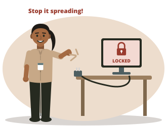
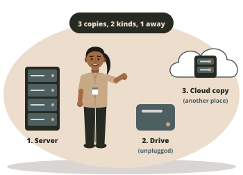

# Session 11.12: When things go wrong

**Day 6, 1:00 to 3:00. Test 6 is at 3:00.** On the map of the six jobs of security, this afternoon uses the last three jobs: **Detect**, **Respond** and **Recover**. The map from Day 1 is now complete.

[Back to the course site](../index.html)

---

## Monday, 8:40

Every file on Kasun's computer ends in `.locked`. A note says: *"Pay USD 20,000, or lose everything."* What should TeaLeaf do? By the end of this afternoon you will know.

## This afternoon you will learn

1. Incident response: five steps.
2. Ransomware, and why paying is risky.
3. Backups: the 3-2-1 rule, and two questions.

---

## 1. Incident response

An **incident** is a risk that has become real: something has gone wrong. This morning, ransomware was a risk with a score of 15. On Monday at 8:40, it became an incident.

### Five steps

| Step | What it means |
|---|---|
| 1. **Prepare** | Before anything happens: a plan, a contact list, tested backups |
| 2. **Detect** | Notice it, and report it at once |
| 3. **Contain** | Stop it spreading |
| 4. **Recover** | Get back to work, from clean backups |
| 5. **Learn** | Find out how it happened, and fix that |

The steps match the map: Govern and Protect (prepare), Detect, Respond (contain), Recover, then back to Identify (learn).

### Contain or recover?

One question decides: **stop it spreading, or get back to work?**

| **Contain: stop it spreading** | **Recover: get back to work** |
|---|---|
| Unplug infected computers | Restore from a clean backup |
| Lock a stolen account | Check it works |
| Do it first, and fast | Only after it is contained |

Contain always comes first. Restoring into a network that is still infected just loses the backup too.

> **Good to know (not in the test): who to tell.** **Sri Lanka CERT**, the national team that helps with cyber incidents (hotline **101**). The **Data Protection Authority**, if personal data was lost or stolen: from 1 January 2027, the PDPA requires personal data breaches to be reported (draft rules propose within 72 hours). And the **affected customers**, so they can protect themselves. Who to tell, and when, is set by the law and can change: check the latest.

## 2. Ransomware

**Ransomware** is malware that locks your files and asks for money to unlock them. It uses **encryption**, the lock from Day 3, against you: only the criminal has the key.

| Stage | What happens | A control we know |
|---|---|---|
| 1. Gets in | A phishing email, a stolen password, or old software | Training, MFA, updates (Days 2, 3) |
| 2. Spreads | It moves to other computers and the server | Firewall, layers, contain fast |
| 3. Steals a copy | Often it copies data first, to threaten a leak | Encryption of stored data (Day 3) |
| 4. Locks and demands | Files are encrypted; a ransom note appears | Offline backups |

### Should TeaLeaf pay?

| Reason not to pay | |
|---|---|
| **No promise** | Criminals may not send the key, or the key may not work |
| **Funds crime** | The money pays for the next attack |
| **Marked as a payer** | A business that pays is often attacked again |
| **Data may still leak** | Stolen copies can still be sold or published |

**With tested offline backups, TeaLeaf does not need to pay.**

## 3. Backups

The **3-2-1 rule**: keep **3** copies of your data, on **2** kinds of storage, with **1** copy away from the office.

For TeaLeaf: the server, an external drive that is unplugged after each backup, and a cloud backup.

A backup folder on the same server is **not** enough. Ransomware locks every copy it can reach, and a fire destroys everything in the building.

### Lose or wait?

Two questions, with two different answers:

| Question | What decides it |
|---|---|
| **How much data can we lose?** | How **often** we back up. Daily backup: lose at most one day of orders. |
| **How long can we be down?** | How **fast** we can restore. A nearby, tested copy: back in hours, not days. |

Test the restore regularly. An untested backup often fails the first time.

> **Good to know (not in the test):** IT teams call these two the **RPO** (how much can we lose?) and the **RTO** (how long can we be down?).

---

## Games for this session

- [A6.4 Ransomware Tabletop](../artifacts/day6/a6-4-ransomware-tabletop.html): make seven decisions against the clock in a ransomware attack.
- [A6.5 Recovery Clock](../artifacts/day6/a6-5-recovery-clock.html): build a 3-2-1 backup plan, then survive a ransomware attack and a fire.
- [A6.6 Response Words Ladder](../artifacts/day6/a6-6-response-words-ladder.html): all thirteen words of the day. Tap **Hear it** to hear each word.

## Check yourself

1. Ransomware is found on three computers. What should Nadee do first?

Contain it: unplug them from the network to stop it spreading.

2. Give two reasons not to pay a ransom.

Any two: there is no promise the key works; it funds crime; TeaLeaf may be attacked again; stolen data may still leak.

3. TeaLeaf's only backup is a folder on the same server. Why is this a problem?

Ransomware locks it too, and a fire destroys it too. Follow the 3-2-1 rule: one copy unplugged, and one away from the office.

4. TeaLeaf backs up once a week. How much data could it lose?

Up to one week of orders. Backing up every day reduces this to one day.

## Test 6: how it works

At 3:00 you answer **two questions** on paper, one about the morning and one about the afternoon. Each question gives a short TeaLeaf situation and asks you to decide something and say why.

1. **Write** (35 min). No books, no phones.
2. **Photo** (5 min). Take clear photos. Make one PDF.
3. **Upload** (10 min) to the LMS. File name: `DBIS11_StudentID_Day6.pdf`
4. **Hand in** (5 min) your paper to the lecturer before you leave.

We mark your **ideas**, not your grammar. To prepare, play the Risk Matrix Plotter, Treat It!, the Ransomware Tabletop and the Recovery Clock again. This is the last test: tomorrow is exam preparation.

## Words to know

| Word | Simple meaning |
|---|---|
| Incident | A risk that has become real: something has gone wrong |
| Contain | Stop an incident from spreading |
| Ransomware | Malware that locks your files and asks for money to unlock them |
| 3-2-1 rule | 3 copies of data, on 2 kinds of storage, with 1 copy away from the office |

**Previous:** [Session 11.11: Managing risk](11-11.html) | **Next:** [Session 11.13: The week on one page](11-13.html)

DBIS-11 Cybersecurity and Cloud Computing. &copy; 2026 Niranga Dharmaratna, School of Computing &amp; Engineering, National Institute of Business Management. This work is licensed under <a href="https://creativecommons.org/licenses/by-nc-sa/4.0/">CC BY-NC-SA 4.0</a>. Illustrations are original and share the same licence. <a href="../LICENSE.html">Licence details</a>.

