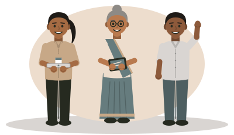

# Session 11.13: The week on one page

**Day 7, 9:00 to 12:00. Exam preparation: no new ideas, and no test today.** This morning we revise the whole week through TeaLeaf.

[Back to the course site](../index.html)

---

## The exam in one sentence

On exam day you will meet a business you have never seen. Everything you need, you have already practised with TeaLeaf.

---

## 1. The week again, one job at a time

| Job | What TeaLeaf does | Day |
|---|---|---|
| **Govern**: set the rules | A risk register with an owner for every risk | 6 |
| | A short security policy, including: no customer data in free AI chatbots | 5 |
| | Choose a cloud provider with a six-point checklist, not only the price | 5 |
| **Identify**: know what you have | List information and its owner; ask what C, I or A would lose | 1, 2 |
| | Score risks: likelihood x impact, on the 5 x 5 matrix | 6 |
| | Know whose job each part is: building or belongings? what do you bring? | 4, 5 |
| **Protect**: keep it safe | Spot tricks; own logins, passphrases, MFA | 2 |
| | Firewall at the gate, VPN on the road, HTTPS | 3 |
| | Encryption (lock) and hashing (fingerprint); no folders left open | 3, 5 |
| **Detect**: spot attacks | Staff report strange emails at once | 2, 5 |
| | Activity logs with personal logins: the diary | 2 |
| | A changed fingerprint shows changed data; an alarm notices an attacker | 3, 6 |
| **Respond**: act fast | Contain first: unplug, lock the account | 6 |
| | Do not pay a ransom | 6 |
| | Tell the Data Protection Authority, the customers, and Sri Lanka CERT | 5, 6 |
| **Recover**: get back to work | 3-2-1 backups, with one copy unplugged | 6 |
| | Back up often (lose less); test restores (wait less) | 6 |
| | Learn: find out how it got in, and fix that | 6 |

## 2. The deciding questions

The week's look-alike words each have one deciding question. Use them in the exam.

| Look-alikes | Deciding question | Day |
|---|---|---|
| Authenticity or accountability | Door or diary? Checked now, or traced later? | 2 |
| Firewall or VPN | Gate or road? | 3 |
| Encryption or hashing | Lock or fingerprint? Can you get the original back? | 3 |
| IaaS, PaaS or SaaS | What do you bring? | 4 |
| Public, private or hybrid cloud | Who shares it? | 4 |
| Provider's job or the customer's | Building or belongings? | 5 |
| Personal data or not | Can it point to a person? | 5 |
| Likelihood or impact | Chance or damage? | 6 |
| Avoid, reduce, transfer, accept | Gone, smaller, moved, or kept? | 6 |
| Prevent, detect, fix | Before, during, or after? | 6 |
| Contain or recover | Stop it spreading, or get back to work? | 6 |
| The two backup questions | Lose or wait? | 6 |

## 3. Four common mistakes

| Mistake | Example | Fix |
|---|---|---|
| Mixing look-alikes | "Use a firewall on hotel Wi-Fi." | Use the deciding question: gate or road? |
| A decision, no reason | "TeaLeaf should not pay." | Add *because...*, with a key word |
| A reason, not applied | "MFA is good for all businesses." | Use the facts about **this** business |
| Loose key words | "The VPN encrypts the website so it is honest." | Use each word exactly as you learned it |

---

## Games for this session

- [A7.2 TeaLeaf Health Check](../artifacts/day7/a7-2-tealeaf-health-check.html): walk through the six jobs and get TeaLeaf's one-page security plan. **Print it or save it as a PDF**: it is the best revision sheet for the exam.
- [A7.3 Revision Arena](../artifacts/day7/a7-3-revision-arena.html): exam-style multiple-choice questions, by learning outcome or all mixed.
- [A7.1 Command Word Decoder](../artifacts/day7/a7-1-command-word-decoder.html): what does the examiner want? And what is wrong with these weak answers?

## Revise each day

| Day | Notes |
|---|---|
| 1 | [11.1](11-01.html), [11.2](11-02.html) |
| 2 | [11.3](11-03.html), [11.4](11-04.html) |
| 3 | [11.5](11-05.html), [11.6](11-06.html) |
| 4 | [11.7](11-07.html), [11.8](11-08.html) |
| 5 | [11.9](11-09.html), [11.10](11-10.html) |
| 6 | [11.11](11-11.html), [11.12](11-12.html) |

**Previous:** [Session 11.12: When things go wrong](11-12.html) | **Next:** [Session 11.14: The exam](11-14.html)

DBIS-11 Cybersecurity and Cloud Computing. &copy; 2026 Niranga Dharmaratna, School of Computing &amp; Engineering, National Institute of Business Management. This work is licensed under <a href="https://creativecommons.org/licenses/by-nc-sa/4.0/">CC BY-NC-SA 4.0</a>. Illustrations are original and share the same licence. <a href="../LICENSE.html">Licence details</a>.

