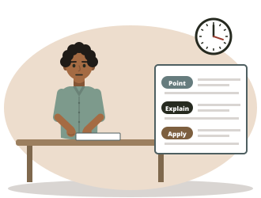
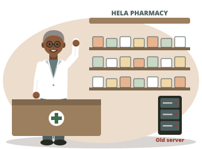

# Session 11.14: The exam: how to win the marks

**Day 7, 1:00 to 4:00. Exam preparation.** This afternoon: the exam paper, command words, Point Explain Apply, and a timed practice scenario with model answers.

[Back to the course site](../index.html)

---

## 1. The exam paper: 2 hours, 100 marks

| Section | What you do | Marks | Suggested time |
|---|---|---|---|
| A | 20 multiple-choice questions. Answer all. | 20 | 20 minutes |
| B | Answer 4 of 6 short questions, 10 marks each. | 40 | 50 minutes (about 12 each) |
| C | One business scenario you have not seen, in 4 parts. | 40 | 45 minutes |
| | Check your answers. | | 5 minutes |

**Marked for ideas, not grammar.** Simple English is fine.

- **Section A:** read every option before choosing. Use the deciding questions. Never leave one blank.
- **Section B:** choose the 4 questions you can apply best. Every 10-mark answer needs Point, Explain, Apply.
- **Section C:** read the scenario twice. Underline the facts about the business. Use them in every part.

## 2. Command words

| Command word | The examiner wants | Shape of the answer |
|---|---|---|
| **Define** | A short, exact meaning | One or two sentences, with an example |
| **Explain** | How or why, with reasons | Point, then *because...*, with key words |
| **Compare** | How two things are alike **and** different | One similarity, then the differences, both sides |
| **Recommend** | A decision for this business, with reasons | Decide, give reasons, apply to the business |

Other phrasings mean the same: *What is meant by* = define. *Why* = explain. *What is the difference* = compare. *Should*, *Advise* = recommend.

## 3. Point, Explain, Apply

| Part | What it does | Roughly |
|---|---|---|
| **Point** | Answer the question | 3 marks |
| **Explain** | Say why, using the key words | 4 marks |
| **Apply** | Use the facts about the business | 3 marks |

A point with no reason gets about 2 marks. A point and a reason, but not applied, gets about 6 or 7. *(These splits are a guide for practice.)*

### A worked answer

**Question:** Explain why Hela Pharmacy should not keep its only backup on the same server. (10 marks)

**Weak (about 2 marks):** "Because it is not safe. Backups should be somewhere else."

**Strong (10 marks):**
- **Point:** A backup on the same server is lost in the same attack.
- **Explain:** Ransomware locks every copy it can reach, and a fire destroys everything in the building. The 3-2-1 rule keeps one copy unplugged and one away.
- **Apply:** Hela's server was locked for two days with no backups; an unplugged drive and a cloud copy would have let it restore.

---

## 4. Timed practice: Hela Pharmacy (Section C, 45 minutes)

> **Hela Pharmacy (Pvt) Ltd** runs three pharmacies in Kandy. It keeps customer names, phone numbers and prescriptions on one old server in the main branch. The owner, Mr Ranil, wants to move to the cloud.
>
> Last month, a staff member clicked a link in a fake email. The server was locked by ransomware for two days. Hela had no backups.

Answer all four parts. Write on paper, without notes, in 45 minutes. Then mark your work with the model answers below.

| Part | Question | Marks |
|---|---|---|
| (a) | Explain two features of the cloud that could help Hela Pharmacy. | 10 |
| (b) | Hela chooses SaaS pharmacy software. Using shared responsibility, explain which security jobs stay with Hela. | 10 |
| (c) | Customer prescriptions are personal data. Explain two duties Hela has under the PDPA. | 10 |
| (d) | Recommend a backup plan, and two other actions, so that the ransomware attack does not happen again. | 10 |

Model answer (a): cloud features

- **Point (2 + 2):** pay for what you use; use it anywhere. (Any two of the five features.)
- **Explain (2 + 2):** no big payment for a new server, a monthly cost instead; records reached over the internet from any place.
- **Apply (1 + 1):** Hela's old server needs replacing, so cash stays free for medicine stock. All three branches see the same records, not only the main branch.

Model answer (b): shared responsibility

- **Point (3):** the provider protects the cloud (building, hardware, and the app itself with SaaS); Hela protects what it puts in it. Building or belongings?
- **Explain (4):** Hela keeps: its data, staff passwords and MFA, who gets access (remove leavers), and its settings (nothing left open by mistake).
- **Apply (3):** the fake-email attack shows it: training and MFA for Hela's staff are Hela's job, not the provider's.

Model answer (c): PDPA duties

- **Point (2 + 2):** prescriptions are personal data: they point to a person. Two duties, for example: use it only for the reason given; keep it safe.
- **Explain (2 + 2):** customers gave it to get medicine, not for other uses such as marketing without consent. Keep it safe with access control, MFA and encryption.
- **Apply (1 + 1):** Hela must not send prescription lists to outside tools; the ransomware attack shows Hela's data was not kept safe; a personal data breach must be reported to the Data Protection Authority.
- Also accepted: only what you need; correct and not kept for ever; have a lawful reason and say it.

Model answer (d): recommend

- **Point (3):** follow the 3-2-1 rule: the server or cloud, an unplugged drive, and one copy away from the pharmacy. Back up daily, and test restores.
- **Explain (4):** ransomware locks connected copies; a fire destroys the building. Two more actions: phishing training (the attack began with a fake email) and MFA. (Also accepted: updates; an incident plan with contain first; never paying a ransom.)
- **Apply (3):** Hela lost two days. With tested daily backups, it loses at most one day, recovers in hours, and does not need to pay.

---

## On the day

1. **Watch the time:** A 20, B 50, C 45, check 5. Move on when time is up.
2. **Circle the command word:** define, explain, compare, recommend. Answer what is asked.
3. **Point, Explain, Apply:** every 10-mark answer needs all three.
4. **Use the deciding questions:** door or diary? gate or road? lock or fingerprint? And the rest, in [Session 11.13](11-13.html).

## Games for this session

- [A7.4 Answer Builder](../artifacts/day7/a7-4-answer-builder.html): build three 10-mark answers about Hela Pharmacy with Point, Explain, Apply, and compare with the model.

**Good luck.**

**Previous:** [Session 11.13: The week on one page](11-13.html)

DBIS-11 Cybersecurity and Cloud Computing. &copy; 2026 Niranga Dharmaratna, School of Computing &amp; Engineering, National Institute of Business Management. This work is licensed under <a href="https://creativecommons.org/licenses/by-nc-sa/4.0/">CC BY-NC-SA 4.0</a>. Illustrations are original and share the same licence. <a href="../LICENSE.html">Licence details</a>.

